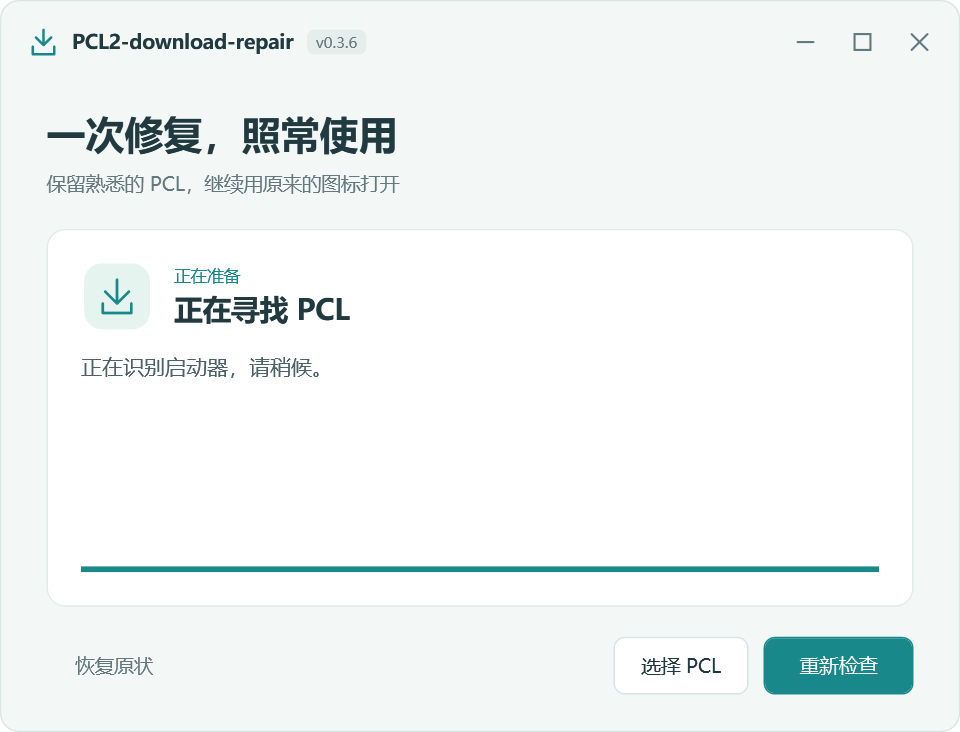

# PCL2-download-repair

**修复一次，以后继续点原来的 PCL 图标。**

让熟悉的下载与整合包导入回到你正在使用的 PCL：把修复文件夹放到启动器旁边，运行一次，工具就会自动识别并接入已适配的正式版、赞助快照版或 PCL CE。之后照常打开原程序，继续使用 PCL 自己的下载页面、安装任务和进度提示。

[**下载最新版**](https://github.com/Plumess/PCL2-download-repair/releases/latest) · [**新手使用教程**](docs/USER-GUIDE.md) · [**查看支持范围**](#当前适配范围)

*首次打开的界面预览，使用程序实际控件渲染；工具会自动寻找附近的 PCL 并开始接入。*

## 少几步操作，保留熟悉的体验

| 你关心的事 | 修复后的使用体验 |
|---|---|
| 不想研究自己是哪一版 | 自动识别附近的启动器，按实际程序结构选择适配方式；找不到时也可以手动选择 |
| 还想用原来的启动方式 | 原 EXE 内容和已有快捷方式保持不变，桌面图标、任务栏入口照常使用 |
| 不想重配游戏和账号 | 保留原有 Minecraft 目录、账号、选中版本与启动参数 |
| 下载和导入要用着顺手 | 恢复原版下载、整合包拖入、手动导入、启动自动导包及在线安装入口，继续调用 PCL 原生下载器与安装器 |
| 更新后不想反复折腾 | 引导入口保留且结构兼容时，启动后自动重新适配；签名组件更新在后台准备，下次正常启动生效 |
| 需要时能撤销 | 工具内点击“恢复原状”，解除本工具的接入 |

下载修复包 → 解压并放到 PCL 旁边 → 关闭 PCL、运行一次修复 → 以后照常打开原图标。

在线适配更新需要能访问签名 Release；GitHub 不通时继续使用本地组件。适配范围见下表，结构大改或入口被清除时仍可能需要新版工具。

这是独立的第三方修复工具。下载包不包含 PCL 启动器、游戏、账号或赞助版文件。

## 第一次使用

1. 下载发布附件 **`PCL2-download-repair-release-<版本号>.zip`**（例如 `0.3.6`），右键选择“全部解压”。
2. 把里面的 **`PCL2-download-repair` 文件夹**放到你平时使用的 PCL 程序旁边。
3. 关闭 PCL，双击文件夹里的 **`PCL2-download-repair.exe`**。
4. 完成后照常点原来的 PCL 图标。以后不用再打开修复工具。

没找到 PCL 时，点“选择 PCL”，选择原启动器的 EXE。不要在压缩包里面直接运行修复工具。

[完整新手教程](docs/USER-GUIDE.md)

## 恢复哪些操作

- 原版游戏入口、版本列表和安装流程。
- 把 ZIP／MRPACK 整合包拖进 PCL。
- 从文件选择框导入整合包。
- 启动时自动导入 `modpack.zip`／`modpack.mrpack`。
- CurseForge、HMCL、MMC／Prism、MCBBS、Modrinth 的原生格式分发。
- 带启动器压缩包及普通压缩包的原生回退处理。
- 在线整合包列表的“点击安装”和单独的“另存为”。
- 版本修改页、无可用版本时的下载入口。

RAR 的支持范围沿用 PCL 本身；不支持的 RAR 需要解压后重新压缩成 ZIP，不能只修改后缀。

Mod、资源包、光影和数据包的原有保存操作继续调用原来的处理器。账号登录、游戏授权和原启动器更新设置均不属于本工具的修改范围。

## 当前适配范围

| 分支 | 验证版本 | 说明 |
|---|---|---|
| 原作者正式版 | 2.99.0.1 | 原入口、导入、整合包安装、安装／另存为回调已验证 |
| 赞助快照版 | 2.99.0.1 | 原入口、原版安装及多种整合包安装已验证 |
| PCL CE | 2.15.1 x64 | 原入口、导入及多种整合包安装已验证 |
| 原生未限制的旧正式版 | 2.12.1 | 保留原生下载，不重复修补 |

当前验证环境为 Windows 10 x64。CE ARM64 不在此版本的支持范围内；其他未列出的版本需要兼容性检查，不能视为全部实测通过。

## 更新后怎么办

PCL 原 EXE 的内容不被改写。常规更新替换 EXE 后，应用旁的引导入口继续加载修复组件，按新程序的实际方法结构重新适配，不依赖固定文件偏移或固定局部变量编号。

遇到结构大改，需要维护者发布新的适配器。可选在线更新使用签名清单，后台检查，不要求用户登录 GitHub；断网或 GitHub 不通时继续使用本地组件。组件更新默认下次正常打开 PCL 生效，不打断正在进行的操作。

本包预置更新通道为 **`plumess/PCL2-download-repair` 的 Release 附件**，并固定发布签名公钥。已安装用户无需填写更新地址或 GitHub 令牌；暂时无法连接时，后台检查会安静跳过，本地修复继续使用。新组件校验通过后供下次正常启动使用，不强制重启 PCL。

如果整个 PCL 文件夹被重新安装，或者新版更换了引导机制，可能需要再次运行新版修复工具。

曾安装早期测试包的用户，建议下载 `0.3.6` 或更新的完整修复包运行一次，以统一引导组件和更新配置；此后按正常更新流程使用。

## 想取消修复

打开 `PCL2-download-repair.exe`，点“恢复原状”。完成后再删除修复文件夹。

不要先删除 `runtime` 或里面的 DLL；原启动器配置仍引用它们时，PCL 可能无法打开。即使已经误删，重新下载修复工具仍可执行“恢复原状”。

## 文件与实现

修复组件集中在 `PCL2-download-repair` 内。原作者分支需要在原 EXE 旁保留应用专属 `.config`；CE x64 需要一个应用本地的 `hostfxr.dll` 入口文件。这些入口是保持原程序及现有快捷方式不变所必需的。

修复在进程内重接原生调用，不用旧版启动器替换新版。运行时提示调用对应 PCL 的原生提示接口；首次安装器使用独立 WPF 界面。

为什么继续点原图标，也能自动加载修复？

原作者正式版和赞助快照版使用 .NET Framework。这个运行时会读取原 EXE 旁同名的 `.exe.config`，例如 `Plain Craft Launcher 2.exe.config`。工具保留原配置的其他节点，只合并本工具所需的 `appDomainManagerAssembly`、`appDomainManagerType` 和组件搜索路径，让 .NET 在运行原程序时先加载一个小型引导组件。这是 .NET 提供的启动扩展机制，原 EXE 不需要改写，快捷方式也不需要换目标。

PCL CE x64 使用另一条入口：应用本地的 `hostfxr.dll` 转发到微软原运行时，只对已登记的启动器加入本进程的 `DOTNET_STARTUP_HOOKS`；钩子执行后恢复原环境变量，避免传给后续启动的子程序。

两条路径最终都会读取 `runtime/current.txt`，选择当前适配器。适配器等 PCL 完成原生启动初始化，再在主窗口创建前按实际方法结构安装 Harmony 内存补丁，重接新版保留的列表加载器、下载器和整合包安装器。游戏目录和账号设置继续由原 PCL 读取。

只要引导入口仍在，PCL 常规更新替换 EXE 后，就能走同样的加载过程；后台取得的新适配器也通过版本指针在下一次正常启动时生效。全目录重装、删除入口文件或宿主机制改变时，可能需要重新运行修复工具。

参考：[微软 AppDomainManager 配置说明](https://learn.microsoft.com/en-us/dotnet/framework/configure-apps/file-schema/runtime/appdomainmanagerassembly-element)、[.NET Startup Hook 设计](https://github.com/dotnet/runtime/blob/main/docs/design/features/host-startup-hook.md)。

本项目参考了 [pcl2-patch](https://github.com/ShiraiFyuya/pcl2-patch) 与 [PCL2-Download-Fix](https://github.com/xiaoqingwagua/PCL2-Download-Fix) 对功能覆盖和结构适配的思路，代码和安装界面独立实现。依赖与许可见 [第三方说明](THIRD-PARTY-NOTICES.md)。

[维护与构建说明](docs/MAINTAINER-GUIDE.md)
